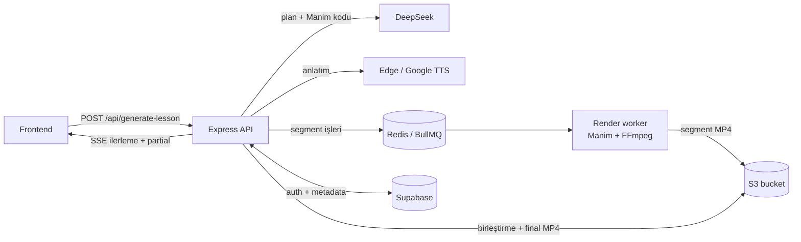

<p align="center">
  <picture>
    <source media="(prefers-color-scheme: dark)" srcset="assets/logo-dark.png">
    
  </picture>
</p>

<p align="center">
  <strong>Bir konu yaz, anlatımlı bir ders videosu al.</strong><br>
  DeepSeek + Manim + TTS ile yapay zekâ destekli eğitim videosu üreten açık kaynak backend.
</p>

<p align="center">
  <a href="LICENSE"></a>
  
  
  
</p>

---

Kara Tahta, öğrencinin yazdığı bir konuyu ya da sorunun fotoğrafını
3Blue1Brown tarzı, seslendirilmiş bir matematik/fen ders videosuna dönüştürür.
Bu repo uygulamanın **backend**'idir: Express API, kullanıcı/veri katmanı ve
video üretim pipeline'ı.

## Özellikler

- **Ders videosu üretimi:** DeepSeek pedagojik bir plan çıkarır, her bölüm için
  Manim kodu ve anlatım metni yazar. Edge TTS (veya Google Cloud TTS)
  seslendirir, Manim + FFmpeg 720p videoyu oluşturur.
- **Canlı akış:** Plan akarken ilk bölüm hemen üretime girer. Video bitmeden
  oynatma başlar (SSE + progressive fMP4 parçaları).
- **Ölçeklenebilir render:** Redis/BullMQ kuyruğu ve ayrı `render-worker`
  süreçleri sayesinde ağır Manim işleri API'den ayrılır ve yatay ölçeklenir.
- **Kara asistan:** Video içinde sorulan soruları o anki kareyi görerek
  (Gemini vision) yanıtlar. Web araması yapabilir, anlık Manim görseli
  çizebilir. Gemini Live ile sesli sohbet de desteklenir.
- **Kartlar:** Bir sorudan 2–4 kartlık görsel anlatım üretir, Instagram
  carousel olarak yayınlayabilir.
- **Katalog ve yayın:** Herkese açık ders kataloğu, YouTube/Instagram/TikTok
  yayını, Google Drive'a kaydetme ve zamanlanmış otomatik içerik üretimi.
- **MCP sunucusu:** `POST /mcp` üzerinden ders ve kart üretimini başka
  yapay zekâ ajanlarına araç olarak sunar.

## Nasıl çalışır



1. Frontend bir konu gönderir. API dersi kaydeder ve bir iş (`202`) döndürür.
2. DeepSeek planı akış halinde üretir. Tamamlanan her segment hemen TTS ve
   Manim kod üretimine girer.
3. Segmentler kuyruğa bırakılır. Worker'lar Manim + FFmpeg ile render edip
   sonucu bucket'a yükler.
4. API segmentleri birleştirip final MP4'ü yazar. İlerleme SSE ile frontend'e
   akar.
5. Geçmişteki dersler kısa ömürlü imzalı URL'lerle oynatılır. Bucket private
   kalır.

Ayrıntılar için [docs/ARCHITECTURE.md](docs/ARCHITECTURE.md).

## Teknoloji

| Katman | Kullanılan |
| --- | --- |
| API | Node.js 22, Express 5 |
| LLM | DeepSeek (OpenAI uyumlu API), opsiyonel Gemini |
| Animasyon | Manim 0.20.1, FFmpeg, LaTeX |
| Ses | Edge TTS, opsiyonel Google Cloud TTS |
| Kuyruk | Redis + BullMQ |
| Auth ve veri | Supabase (Auth + Postgres) |
| Medya | S3 uyumlu private bucket veya local disk |

## Hızlı başlangıç

En kolay yol Docker'dır. İmaj Node, Python, Manim, LaTeX, Edge TTS ve FFmpeg'i
içerir.

```bash
git clone https://github.com/ethosoftai/karatahta-oss.git
cd karatahta-oss
cp .env.example .env          # en az DEEPSEEK_API_KEY değerini doldurun
docker build -t karatahta .
docker run --env-file .env -p 8080:8080 karatahta
```

Çalıştığını doğrulayın:

```bash
curl http://localhost:8080/api/config
```

`.env.example` varsayılan olarak `AUTH_REQUIRED=false` ile local modda
başlar. Kullanıcı hesapları ve kalıcı ders geçmişi için Supabase, kalıcı
medya için bir S3 bucket tanımlayın. Bkz. [docs/CONFIGURATION.md](docs/CONFIGURATION.md).

<details>
<summary>Docker olmadan çalıştırma</summary>

Sistemde FFmpeg, LaTeX ve Manim'in sistem bağımlılıkları (Cairo, Pango)
kurulu olmalıdır.

```bash
npm ci
python -m venv .venv
source .venv/bin/activate
pip install manim==0.20.1 edge-tts==7.2.8
npm run dev
```

Backend `http://localhost:8080` adresinde çalışır. Frontend'in varsayılan
origin'i `http://localhost:3001`'dir.

</details>

### Süreç rolleri

Aynı imaj `PROCESS_ROLE` değişkenine göre üç farklı süreç olarak çalışır:

| `PROCESS_ROLE` | Komut | Görev |
| --- | --- | --- |
| *(boş)* | `npm start` | API sunucusu |
| `render-worker` | `npm run render-worker` | Kuyruktan Manim render işleri |
| `social-worker` | `npm run social-publisher` | Sosyal medya yayını ve zamanlayıcı |

Kuyruk kullanmak için `RENDER_QUEUE_ENABLED=true` ve `REDIS_URL` tanımlayın.
Kuyruk kapalıyken API render'ı kendi içinde yapar.

## Belgeler

| Belge | İçerik |
| --- | --- |
| [docs/ARCHITECTURE.md](docs/ARCHITECTURE.md) | Mimari, pipeline, render worker'lar, çalışma zamanı sınırları, repo haritası |
| [docs/CONFIGURATION.md](docs/CONFIGURATION.md) | Tüm ortam değişkenleri, Supabase migration'ları, bucket kurulumu |
| [docs/API.md](docs/API.md) | HTTP, WebSocket ve MCP uç noktaları |
| [docs/DEVELOPMENT.md](docs/DEVELOPMENT.md) | Test, doğrulama ve geliştirici notları |
| [DEPLOYMENT.md](DEPLOYMENT.md) | Railway ve VPS deployment |
| [SUPABASE_SETUP.md](SUPABASE_SETUP.md) | Supabase projesi ve Auth kurulumu |
| [AUTH_EMAIL_SETUP.md](AUTH_EMAIL_SETUP.md) | Google OAuth, SMTP ve e-posta şablonları |
| [TIKTOK_KURULUM.md](TIKTOK_KURULUM.md) | TikTok yayın entegrasyonu |
| [sistem.md](sistem.md) | Planlayıcı ve kod üretici sistem promptları |

## Katkıda bulunma

Katkılara açığız! Başlamadan önce [CONTRIBUTING.md](CONTRIBUTING.md) dosyasını
okuyun. Değişiklik göndermeden önce testleri çalıştırın:

```bash
npm test
```

Güvenlik açıklarını herkese açık issue yerine [SECURITY.md](SECURITY.md)
dosyasında anlatılan özel kanal üzerinden bildirin.

## Lisans

Kara Tahta [GNU Affero General Public License v3.0](LICENSE) ile
lisanslanmıştır. Projeyi değiştirip bir ağ hizmeti olarak sunarsanız, değiştirilmiş
kaynak kodunu kullanıcılarınızla paylaşmanız gerekir.

<p align="center"><sub>❤️ ile <a href="https://ethosoft.org">Ethosoft</a> tarafından geliştirildi.</sub></p>
