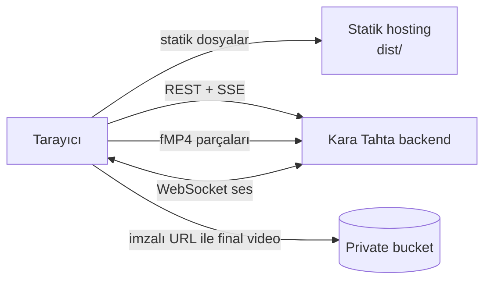

<p align="center">
  <picture>
    <source media="(prefers-color-scheme: dark)" srcset="../assets/logo-dark.png">
    
  </picture>
</p>

<p align="center">
  <strong>Bir konu yaz, anlatımlı bir ders videosu al.</strong><br>
  Kara Tahta'nın tarayıcıda çalışan arayüzü: ders stüdyosu, canlı video oynatıcı ve Kara asistan.
</p>

<p align="center">
  <a href="../LICENSE"></a>
  
  
  
  
</p>

---

Bu klasör Kara Tahta'nın **frontend**'idir: Vite + React + TypeScript ile
yazılmış, statik olarak yayınlanabilen tek sayfalık bir uygulama. Bütün iş
(ders üretimi, auth, depolama) [backend](../README.md) tarafında yapılır.
Frontend yalnız API'ye istek atar ve sonucu gösterir.

## Özellikler

- **Ders stüdyosu:** Konu yazılır ya da sorunun fotoğrafı yüklenir. Plan,
  segmentler ve üretim ilerlemesi canlı olarak görünür.
- **Canlı oynatma:** Video bitmeden oynatma başlar. Manim'in ürettiği fMP4
  parçaları MediaSource ile aynı zaman çizgisine eklenir. Akış başarısız
  olursa arayüz final videoyu bekler.
- **Kara asistan:** Video içinde yazılı soru sorma ve Gemini Live ile sesli
  sohbet (AudioWorklet üzerinden mikrofon akışı).
- **Kartlar ve katalog:** Sorudan görsel kart üretimi, herkese açık ders
  kataloğu ve ders geçmişi.
- **Hesaplar:** E-posta/şifre ve Google OAuth ile giriş, ücretsiz deneme
  kotası göstergesi, ilk girişte karşılama turu.
- **Geliştirici portalı:** Yetkili hesaplar için backend seçici, sağlık
  kontrolleri ve ders başına iş metrikleri. Bkz.
  [Geliştirici portalı](#geliştirici-portalı).

## Hızlı başlangıç

Önce backend'i çalıştırın ([ana README](../README.md#hızlı-başlangıç)).
Varsayılan olarak `http://localhost:8080` adresini dinler. Ardından:

```bash
cd frontend
npm ci
cp .env.example .env
npm run dev
```

Uygulama `http://localhost:3001` adresinde açılır. Geliştirme sunucusu `/api`
ve `/renders` isteklerini `KARA_BACKEND_URL` adresine (varsayılan
`http://localhost:8080`) proxy eder. Bu sayede ek ayar gerekmez.

> [!NOTE]
> Backend'in `CORS_ORIGIN` listesinde `http://localhost:3001` bulunmalıdır.
> Backend'in `.env.example` dosyası bunu varsayılan olarak içerir.

## Yapılandırma

Bütün değişkenler isteğe bağlıdır. `VITE_` ile başlayanlar build sırasında
koda gömülür, bu yüzden bunlara **asla gizli değer yazmayın**.

| Değişken | Ne zaman | Açıklama |
| --- | --- | --- |
| `VITE_API_BASE_URL` | build | Backend adresi. Boşsa istekler aynı origin'e (`/api`, `/renders`) gider. |
| `KARA_BACKEND_URL` | yalnız `npm run dev` | Vite proxy'sinin hedefi. Varsayılan `http://localhost:8080`. |
| `VITE_VPS_API_BASE_URL` | build | Geliştirici portalındaki ikinci backend. Boşsa `VITE_API_BASE_URL` kullanılır. |
| `VITE_ADMIN_EMAILS` | build | Geliştirici portalını görebilecek e-postalar, virgülle ayrılmış. Boşsa portal kimseye görünmez. |

Frontend hiçbir zaman Supabase service-role anahtarı, bucket erişim anahtarı
ya da LLM API anahtarı taşımaz. Auth istekleri backend üzerinden yapılır.
Frontend yalnız kullanıcının oturum token'ını saklar ve korumalı isteklerde
`Authorization: Bearer ...` başlığıyla gönderir. Videolara backend'in
ürettiği kısa ömürlü imzalı URL'lerle erişilir.

## Geliştirici portalı

Frontend'de normal kullanıcılardan gizlenen iki geliştirici aracı vardır:

- **Geliştirici portalı (kenar çubuğu):** API isteklerinin hangi backend'e
  gideceğini tarayıcı bazında seçer ve backend'lerin sağlık durumunu gösterir.
- **Geliştirici konsolu (stüdyo):** Aktif dersin iş kimliğini, durumunu,
  üretilen segment sayısını, oynatma tamponunu ve ham log çıktısını gösterir.

Portal, birbirinin yedeği olan iki backend ile çalışmak için tasarlanmıştır:

| Mod | Davranış |
| --- | --- |
| **Railway** (varsayılan) | Bütün istekler `VITE_API_BASE_URL` adresine gider. |
| **VPS** | Bütün istekler `VITE_VPS_API_BASE_URL` adresine gider. |
| **Hibrit** | VPS birincildir, birincil backend otomatik yedektir. Yalnız `GET`/`HEAD`/`OPTIONS` istekleri 502/503/504 yanıtlarında diğer sunucuya geçer. |

Bir ders üretimi başladığında aktif backend ders bitene kadar kilitlenir.
Böylece iş, SSE akışı ve video parçaları iki sunucu arasında bölünmez.
Seçilen mod tarayıcının `localStorage`'ında (`karaBackendMode`) saklanır.

Mod adları ilk kurulumdan kalmadır ve herhangi bir sağlayıcıya bağlı değildir.
"Railway" birincil backend, "VPS" ikincil backend anlamına gelir. Tek bir
backend çalıştırıyorsanız `VITE_VPS_API_BASE_URL` değerini boş bırakın.
Üç mod da aynı sunucuya gider ve portal yalnız sağlık kontrolü ve konsol için
kullanılır.

**Portalı açmak için** kendi e-posta adresinizi build sırasında tanımlayın:

```env
VITE_ADMIN_EMAILS=siz@ornek.com,ekip@ornek.com
```

Bu adreslerle giriş yapan kullanıcılar portalı ve konsolu görür.

> [!WARNING]
> Bu yalnız arayüzde yapılan bir gizlemedir, **güvenlik sınırı değildir**.
> E-posta listesi derlenmiş JavaScript'in içinde herkese açık durur. Portalın
> kullandığı sağlık uç noktaları da backend'de yetki kontrolü yapmaz. Gizli
> kalması gereken bir bilgiyi bu araçlara eklemeyin ve yetki kontrolünü her
> zaman backend'de yapın.

## Mimari



Bir dersin üretimi frontend tarafında şöyle ilerler:

1. Konu `POST /api/generate-lesson` ile gönderilir. Backend `202` ve iş
   bilgisini döndürür.
2. İş durumu `/api/jobs/:id/events` SSE akışından izlenir. Bağlantı koparsa
   `/api/jobs/:id` sorgulaması kullanılır.
3. Hazır video parçaları `/api/jobs/:id/stream-manifest` üzerinden sırayla
   alınır ve `progressiveManimPlayer.js` ile MediaSource'a eklenir.
4. Ders bitince backend final MP4'ü yazar. Geçmişteki dersler
   `/api/lessons/:id/video-url` ile yeni imzalı URL alınarak oynatılır.

API sözleşmesinin tamamı için [docs/API.md](../docs/API.md).

### Kod haritası

```text
frontend/
├── index.html                          giriş HTML'i, SEO/OG etiketleri
├── public/                             logo ve Apache SPA ayarı (.htaccess)
├── src/
│   ├── main.tsx                        API adresleri, React başlangıcı, MathJax
│   ├── App.tsx                         AuthGate + Workspace, legacy yükleyici
│   ├── components/
│   │   ├── AuthGate.tsx                e-posta/şifre ve Google OAuth
│   │   ├── WelcomeTour.tsx             ilk giriş turu
│   │   ├── Workspace.tsx               ana uygulama kabuğu
│   │   └── workspace/                  Home, Studio, Cards, Katalog, LiveTeacher,
│   │                                   Settings ekranları ve Sidebar
│   ├── legacy/
│   │   ├── app.js                      API, auth, iş, geçmiş ve UI orkestrasyonu
│   │   ├── backendRouter.js            geliştirici portalının backend seçicisi
│   │   ├── progressiveManimPlayer.js   MediaSource/fMP4 canlı oynatıcı
│   │   ├── karaLiveClient.js           Gemini Live sesli sohbet istemcisi
│   │   └── karaLiveWorkletProcessor.js mikrofon AudioWorklet'i
│   └── styles/                         base.css, theme.css
└── test/                               node:test birim testleri
```

> [!IMPORTANT]
> React bileşenleri sayfanın iskeletini çizer, davranışın büyük kısmı ise
> `src/legacy/app.js` içindedir ve DOM'a `id` seçicileriyle bağlanır. Bir
> bileşende `id` değiştirirken ya da silerken `app.js` içindeki karşılığını da
> güncelleyin. Aksi halde auth, sohbet veya video akışı sessizce bozulabilir.

## Yayınlama

`npm run build` çıktısı `dist/` klasörüdür ve herhangi bir statik hosting
hizmetinde yayınlanabilir. Sunucu, bilinmeyen yolları `index.html`'e
yönlendirmelidir (SPA fallback).

| Hedef | Hazır dosya |
| --- | --- |
| Cloudflare Workers | [`wrangler.toml`](wrangler.toml), `npx wrangler deploy` |
| Vercel | [`vercel.json`](vercel.json) |
| Apache / cPanel | [`public/.htaccess`](public/.htaccess), build'e kopyalanır |
| Nginx ve diğerleri | `try_files $uri /index.html;` |

Yayınlamadan önce:

- `VITE_API_BASE_URL` değerini backend adresinize ayarlayın ya da aynı origin
  üzerinden `/api` ve `/renders` yollarını backend'e yönlendirin.
- Frontend adresini backend'in `CORS_ORIGIN` listesine ekleyin.
- Google OAuth kullanıyorsanız backend'in `AUTH_REDIRECT_URL` değerini ve
  Supabase'deki Redirect URL listesini frontend adresinize göre ayarlayın.
- `index.html` içindeki başlık, açıklama ve OG etiketlerini kendi sitenize
  göre düzenleyin.

## Geliştirme

```bash
npm test            # node:test birim testleri
npm run typecheck   # TypeScript kontrolü
npm run build       # typecheck + production build
```

Değişiklik göndermeden önce üçünün de geçtiğinden emin olun. Katkı kuralları
için [CONTRIBUTING.md](../CONTRIBUTING.md).

### Sorun giderme

| Belirti | Kontrol edin |
| --- | --- |
| `No 'Access-Control-Allow-Origin'` | Backend'in `CORS_ORIGIN` listesinde frontend adresi var mı? |
| Canlı video başlamıyor, final videoyu bekliyor | `/api/config` içindeki progressive bayrakları ve `stream-manifest` yanıtı |
| Geçmişteki video açılmıyor | `/api/lessons/:id/video-url` yanıtı ve bucket CORS ayarı |
| Giriş ekranı sürekli geri dönüyor | Backend auth ayarları ve oturum yenileme isteği |
| Google girişi yanlış adrese dönüyor | Backend `AUTH_REDIRECT_URL` ve Supabase Redirect URL listesi |
| Geliştirici portalı görünmüyor | Giriş yapılan e-posta `VITE_ADMIN_EMAILS` içinde mi? Değişkenden sonra yeniden build alındı mı? |

## Lisans

Frontend, projenin geri kalanı gibi [GNU Affero General Public License v3.0](../LICENSE)
ile lisanslanmıştır.

<p align="center"><sub>❤️ ile <a href="https://ethosoft.org">Ethosoft</a> tarafından geliştirildi.</sub></p>
